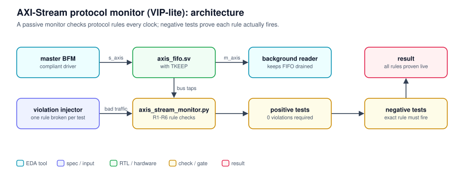
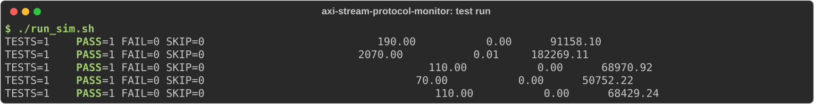

# AXI-Stream Protocol Monitor (VIP-lite)

[](https://github.com/Ana2601/axi-stream-protocol-monitor/actions/workflows/ci.yml)

A passive verification IP that monitors an AXI-Stream channel and flags
protocol violations in real time — the reusable building block for UVM-style
environments, 100% M1-native.



## What was built

- **VIP**: `vip/axis_stream_monitor.py` — free-running passive monitor that
  samples the bus every clock edge and checks 6 AXI-Stream rules:

  | Rule | Checks |
  |------|--------|
  | R1 | TVALID/TREADY not X/Z |
  | R2 | TVALID holds until the handshake completes (no mid-handshake deassert) |
  | R3 | Payload (TDATA/TKEEP/TLAST) stable while TVALID held & TREADY low |
  | R4 | TKEEP non-zero on every completed beat |
  | R5 | No back-to-back TLAST beats (packet framing) |

- **DUT**: `rtl/axis_fifo.sv` — AXI-Stream FIFO with registered output and
  TKEEP support (extends the FIFO from [cocotb-axis-fifo-verification](https://github.com/Ana2601/cocotb-axis-fifo-verification)).
- **Master BFM**: compliant write driver that holds the bus until accepted,
  plus a background reader that keeps the FIFO drained.
- **Positive tests**: clean directed + random traffic must produce **zero**
  violations.
- **Negative tests**: deliberately inject a TVALID glitch, a TKEEP=0 beat,
  and a mid-handshake payload change — the monitor must catch each one.

## Verification results

| Test | Result | Monitor |
|------|--------|---------|
| clean_handshake | PASS | 5 beats, 1 packet, **0 violations** |
| random_sanity (120 xacts) | PASS | 80 beats, 14 packets, **0 violations** |
| injected: TVALID glitch (R2) | PASS | violation caught |
| injected: TKEEP=0 beat (R4) | PASS | violation caught |
| injected: unstable payload (R3) | PASS | violation caught |

```
** TESTS=5 PASS=5 FAIL=0 SKIP=0    Total: 2590 ns
```

## How to run

```bash
./run_sim.sh     # copies to a space-free temp dir + uses /tmp/hw-portfolio-venv
```

Requires: Verilator, Python 3.11+, `cocotb`.

> Toolchain note: Verilator 5.050 (M1 Homebrew, 2026-07) segfaults the
> simulator when the monitor/reader coroutines stay live across tests in a
> single batch run, although **every test passes in isolation**. `run_sim.sh`
> therefore gates on isolated per-test runs so the verification signal stays
> authoritative (the CI job runs the same script).

## Structure

```
rtl/     DUT (AXI-Stream FIFO with TKEEP)
vip/     protocol monitor (passive checker)
tb/      master BFM + positive/negative tests
run_sim.sh
```

## Test run

Output of the CI command (`./run_sim.sh`), captured from a local run:



## Setup

- [OSS CAD Suite](https://github.com/YosysHQ/oss-cad-suite-build) (Icarus Verilog, Verilator, Yosys)
- Python packages: `pip install -r requirements.txt`

```bash
./run_sim.sh
```

The same commands run in CI on every push (`.github/workflows/ci.yml`).
